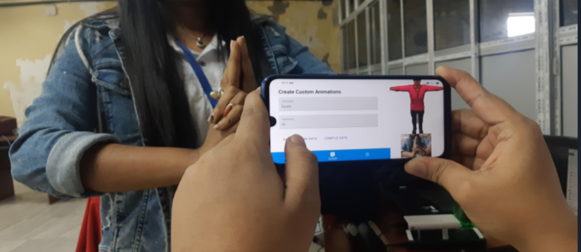

# ACM-HACK-A-DAY-2020
ACM 2020 HACK A DAY

Mobile app that eases and  helps the deaf and dumb interact and communitcate.

# A reto for this hackathon written now after 6+ more years of experience in Software Eng

- The quality of judging was not up to the mark, they undervalued the utility of actually making avaialble AI infra at that time usable and accesible to deaf and dumb people.
- They undervalued the effort put into the app, its UX and UI and the 3D model because we believed if a person is to stare at an app to communicate all the time it should be fluid, it should have 3D models it should be optimized to run on cheaper mobile devices
- These optimizations were also undervalued
- I don't blame the judges, we had a difference in philosophy perhaps but I strongly believed my philosophy to be correct and after 6+ more years of being in software engineering, product development and startups I still do.

 > Our same team (more or less) went onto win Smart India Hackathon: Software Edition. Which is a much more competitive hackathon hosted at the national level, so I don't have too many hard feelings about this. 

~ Anubhav
